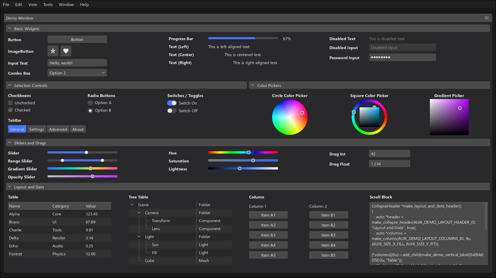

# Auik Demo

`auik-demo` is a small reproducible demo module for Auik. It builds a showcase window with the standard demo sections:

- main menu bar
- basic widgets
- selection controls
- color pickers
- sliders and drags
- layout and data widgets

## Screenshots
<a href="./screenshots/demo.png">
    
</a>

## Integration

Add both Auik and the demo module before compiling the final host theme:

```cmake
add_subdirectory(modules/auik)
add_subdirectory(modules/auik-demo)

compile_auik_css_theme("${AUIK_BASE_THEME}"
    INPUT_FOLDERS
        "${AUIK_DEMO_CSS_DIR}"
        "${CMAKE_CURRENT_SOURCE_DIR}/src/ui"
)

target_sources(my_app PRIVATE ${AUIK_CSS_SRC})
target_include_directories(my_app PRIVATE ${AUIK_CSS_INCLUDE_DIR})
target_link_libraries(my_app PRIVATE auik auik-demo)
add_dependencies(my_app ${AUIK_CSS_TARGET})
```

`AUIK_DEMO_CSS_DIR` contains demo-specific styles and public style ids. Put it before application CSS folders if the application should be able to override demo styles.

## Runtime Setup

Include the public header:

```cpp
#include <auik/demo.hpp>
```

Before creating the demo window, configure demo icon images:

```cpp
Font *ui_font = /* host-provided loaded UI font */;
if (!auik::configure_demo_icons(ui_font, dpi))
{
    // The supplied font did not contain any supported star/heart fallback glyphs.
}
```

`auik-demo` does not ship fonts. The host must provide a loaded `Font*`. The demo tries common fallback glyphs for the star and heart image buttons and stores them in the Auik image cache as:

- `AUIK_DEMO_ICON_STAR`
- `AUIK_DEMO_ICON_HEART`

Then create the demo UI:

```cpp
auto *menu = auik::make_demo_main_menu_bar();
auto *window = auik::make_demo_window();
```

Attach those widgets to the same root/window tree used by the host application. `make_demo_main_menu_bar()` returns a full-width menu bar. `make_demo_window()` returns a decorated demo window containing all demo sections.


## Notes

- The demo window is built from existing Auik widgets only.
- If the host theme does not include `AUIK_DEMO_CSS_DIR`, demo labels will still render, but demo-specific styling such as bold labels will be missing.

## License
This project is licensed under the  [MIT License](LICENSE).

## Contacts
For any questions or feedback, you can reach out via [email](mailto:wusikijeronii@gmail.com) or open a new issue.